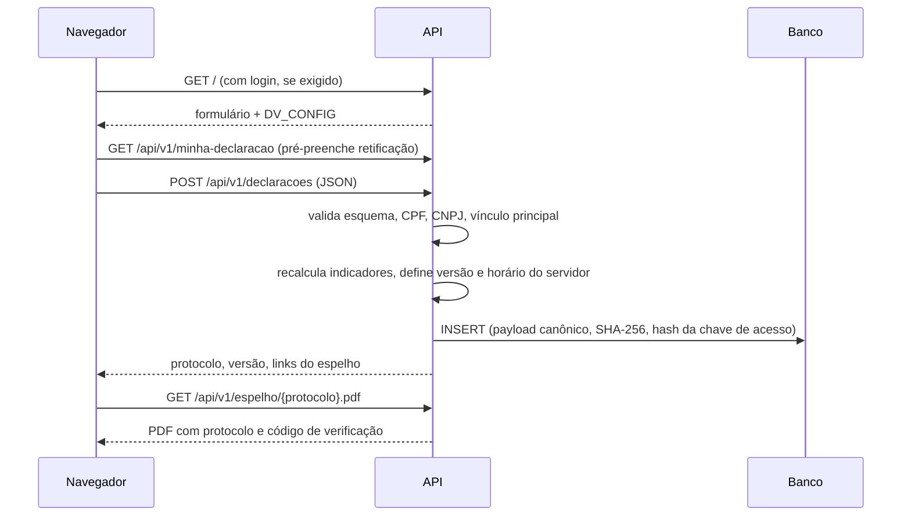
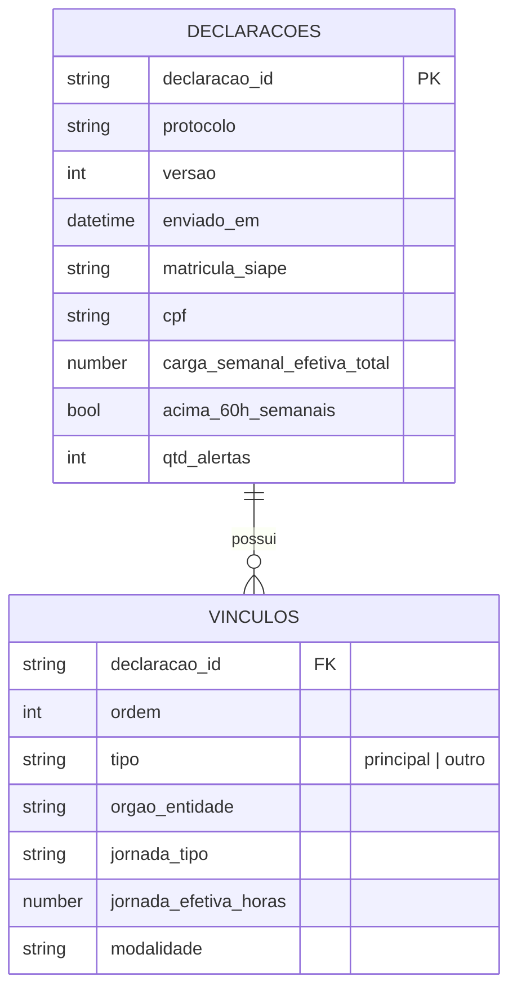

# Arquitetura

## Visão geral

Uma aplicação web única (FastAPI) serve o formulário, recebe os envios, guarda cada versão e expõe os dados para integração. O login institucional, quando usado, é feito por um proxy reverso na frente da aplicação, o que mantém o código independente do provedor de identidade de cada órgão.

```mermaid
flowchart LR
  S[Servidor(a)] -->|HTTPS| P[Proxy reverso<br/>HTTPS + login institucional]
  P -->|X-Remote-User| A[Aplicação FastAPI]
  A --> F[Formulário HTML]
  A --> V[Validação<br/>JSON Schema + regras]
  V --> DB[(SQLite / PostgreSQL<br/>versões + hash)]
  A --> E[Espelho PDF/HTML]
  E -->|download| S
  S -->|junta e assina| SEI[(Processo SEI)]
  PIPE[Pipelines / Power BI] -->|Bearer token| I[/api/v1/integracao/]
  I --> DB
  GP[Equipe de GP] -->|login + DV_ADMINS| E
```

## Componentes

| Componente | Arquivo | Responsabilidade |
|---|---|---|
| Formulário | `app/static/formulario.html` | Interface, validação imediata, prévia dos indicadores. Um único arquivo, sem build; funciona também como página estática (piloto). |
| API | `app/main.py` | Rotas de formulário, ingestão, espelho, verificação e integração. |
| Regras | `app/rules.py` | CPF/CNPJ, regras condicionais, indicadores de triagem, achatamento em tabelas. |
| Armazenamento | `app/storage.py` | Tabela append-only `declaracoes` e visão `declaracoes_atuais`. |
| Autenticação | `app/auth.py` | Modo `none` ou `proxy`; token Bearer para integração. |
| Espelho | `app/espelho.py` | PDF (ReportLab) e HTML para o SEI. |
| Contrato de dados | `schema/declaracao_vinculos.schema.json` | Fonte de verdade do formato; validado na ingestão e na CI. |

## Fluxo de envio



## Modelo de dados

Cada envio é um documento JSON (ver `schema/`). Para análise, é achatado em duas tabelas relacionadas por `declaracao_id`:



Identidade do declarante: com login, a chave é o login institucional; sem login, a matrícula SIAPE. O `declaracao_id` é estável entre versões; `versao` cresce a cada retificação. Nada é sobrescrito, o que preserva a trilha de auditoria exigida para fins disciplinares.

## Segurança

- Ingestão protegida pelo login institucional (modo `proxy`) ou pela rede interna (modo `none`).
- Integração (`/api/v1/integracao/*`) só com token Bearer, comparado em tempo constante. Essas rotas ficam fora do login do proxy e, por isso, não aceitam identidade por cabeçalho.
- Espelho acessível ao próprio declarante (login ou chave aleatória entregue no envio), aos logins em `DV_ADMINS` e a quem tem o token. Protocolo inexistente e acesso negado respondem igual (404).
- Rota de verificação pública devolve só autenticidade, versão e data, sem dados pessoais.
- Cabeçalhos `no-store`, `nosniff` e `no-referrer` em todas as respostas.

## Decisões registradas

- [ADR 0001](adr/0001-aplicacao-unica-fastapi.md): aplicação única em FastAPI com formulário estático.
- [ADR 0002](adr/0002-login-por-proxy-reverso.md): login institucional delegado ao proxy reverso.
- [ADR 0003](adr/0003-armazenamento-append-only.md): armazenamento append-only com hash.
- [ADR 0004](adr/0004-espelho-pdf-para-sei.md): espelho PDF/HTML para o SEI antes da integração por WebService.

## Piloto no claude.ai

O mesmo `formulario.html` foi publicado em out/2026 como página do claude.ai, usando o armazenamento da plataforma (modo `artifact`, padrão quando `window.DV_BACKEND` não é definido). Esse modo exige conta claude.ai da organização e serve só para validação. Em produção, use a API deste repositório (`DV_BACKEND="api"`, injetado automaticamente pela rota `/`).
