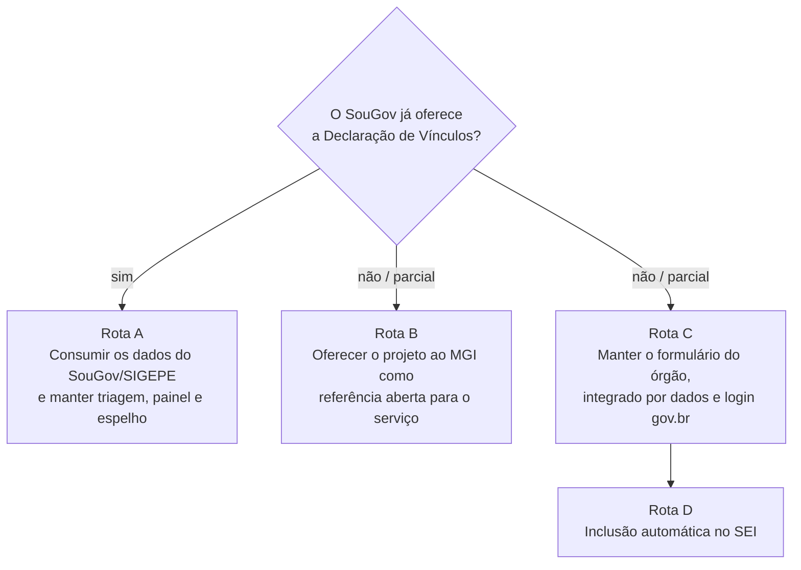

# Fase 2 – Disponibilização e integração com SIGEPE/SouGov.br

Proposta para discussão com o órgão setorial do SIPEC (MS) e o órgão central (SGP/MGI). Os pontos marcados como **a confirmar** dependem de informação que não está pública ou que precisa ser obtida com o MGI, o Serpro ou a gestão do SEI.

## Ponto de partida normativo

A IN SGP/MGI nº 30/2025 (texto compilado publicado pelo MGI) dispõe que:
- o Formulário de Declaração de Vínculos será preenchido **preferencialmente no SouGov** e, se o sistema não estiver disponível, a unidade de gestão de pessoas do órgão o disponibilizará (art. 6º, § 2º);
- as informações serão confirmadas, entre outros meios, em **sistemas informatizados integrados** de registro de dados funcionais (art. 7º, parágrafo único, III);
- o monitoramento é **periódico**, inclusive dos inativos (art. 7º, parágrafo único, VII).

Isso torna o SouGov o canal preferencial e coloca este projeto como a solução prevista para quando o serviço não estiver disponível no SouGov. Ele também pode servir de referência para a construção desse serviço. Fonte: [IN 30/2025 compilada (gov.br/servidor)](https://www.gov.br/servidor/pt-br/acesso-a-informacao/gestao-de-pessoas/sistema-de-carreiras/IN30de2025AcumulaoCOMPILADA.pdf).

## Caminhos possíveis

### Rota A – Consumir o que já existe no SouGov/SIGEPE
**Quando:** se o MGI já disponibiliza, ou vai disponibilizar, a declaração no SouGov.
- O formulário local deixa de coletar e passa a **importar** as declarações feitas no SouGov, por extração do SIGEPE/SIAPE ou API que o MS tenha contratado. O meio exato é **a confirmar** com a Central SIPEC e o Serpro.
- Continuam úteis: indicadores de triagem, painel de análise, cruzamento com CNES/escalas, espelho para o SEI e a API para dashboards. O esquema `declaracao_vinculos` funciona como camada de normalização.
- **Ação:** consultar a Central SIPEC sobre a existência e o cronograma do serviço e sobre os meios de extração disponíveis ao órgão.

### Rota B – Propor o projeto como referência ao órgão central
**Quando:** se o serviço ainda não existe no SouGov.
- O repositório é público (MIT), tem esquema de dados documentado e reproduz os Anexos II a IV da IN. Pode ser oferecido à SGP/MGI como especificação funcional e de dados para o serviço no SouGov.
- **Ação:** ofício da unidade, pelo órgão setorial do MS, à SGP/MGI apresentando o projeto, o esquema e o resultado do piloto, com oferta de cooperação técnica.
- **Ganho:** se adotado, todos os órgãos do SIPEC passam a ter o mesmo formato de dados, o que viabiliza cruzamentos entre órgãos (art. 7º, parágrafo único, III).

### Rota C – Formulário do órgão integrado por dados e por login
**Quando:** enquanto não houver serviço no SouGov (cenário previsto no art. 6º, § 2º).
1. **Login gov.br (Login Único):** credenciar a aplicação junto ao gov.br e usá-lo no proxy OIDC (`deploy/oauth2-proxy`). Traz CPF verificado e a mesma conta que o servidor usa no SouGov. O processo de credenciamento é **a confirmar** com a área de TI do MS.
2. **Pré-preenchimento com dados do SIAPE:** nome, cargo, lotação, jornada e situação funcional vindos de base oficial, o que reduz erros e permite comparar o declarado com o registrado. Depende de acesso do órgão a extrações do SIAPE/SIGEPE ou a APIs; a forma é **a confirmar**. A arquitetura já comporta isso como um módulo de leitura que alimenta `/api/v1/sessao`.
3. **Divulgação pelo canal do servidor:** link no portal/intranet e comunicação aos servidores; o SouGov não permite que um órgão publique formulários próprios, o que também é **a confirmar** com a Central SIPEC.
4. **Devolução ao SIGEPE:** registrar no assentamento funcional o resultado da análise de acumulação, pelo módulo ou rotina que a unidade já usa. A automação dessa etapa depende da Rota A ou de API de escrita, hoje **não identificada**.

O MGI já opera integrações credenciadas por API com os órgãos em outros temas, como o envio de dados do PGD ([API de dados do PGD](https://www.gov.br/servidor/pt-br/assuntos/programa-de-gestao/api-de-dados/)). É um precedente útil para propor um fluxo semelhante para a declaração de vínculos.

### Rota D – Inclusão automática no SEI
- O espelho HTML (`/api/v1/espelho/{protocolo}.html`) já está no formato adequado para criar um documento no SEI.
- Com a aplicação cadastrada como sistema autorizado nos WebServices do SEI do MS, o envio pode gerar o documento diretamente no processo do servidor, que só precisa assiná-lo. As operações e o procedimento de cadastro são **a confirmar** com a gestão do SEI do MS.
- **Implementação prevista:** módulo `app/integracoes/sei.py`, ativado por variável de ambiente, chamado após o `POST` bem-sucedido, com fila de reenvio em caso de falha.

## Recomendação

1. **Agora:** consultar a Central SIPEC (Rota A) e, em paralelo, colocar o formulário do órgão em produção com login de rede e espelho manual (fase 1).
2. **Curto prazo (3 a 6 meses):** login gov.br e pré-preenchimento com dados do SIAPE (Rota C), se houver meio de acesso; cadastro nos WebServices do SEI (Rota D).
3. **Médio prazo:** apresentar o projeto à SGP/MGI como referência para o serviço no SouGov (Rota B), com o resultado do uso no INTO.

## Perguntas a levar ao MGI, ao Serpro e à TI do MS

1. A Declaração de Vínculos da IN 30/2025 está ou estará disponível no SouGov? Com qual cronograma?
2. Se estiver, como o órgão obtém os dados declarados (extração, relatório, API)?
3. Quais extrações ou APIs do SIAPE/SIGEPE o MS já tem contratadas e quais dados funcionais podem alimentar o pré-preenchimento?
4. Qual o procedimento para credenciar uma aplicação do MS no Login Único gov.br?
5. Qual o procedimento para cadastrar um sistema nos WebServices do SEI do MS e quais operações são liberadas?
6. O órgão central tem interesse em receber o projeto como referência aberta para o serviço?
